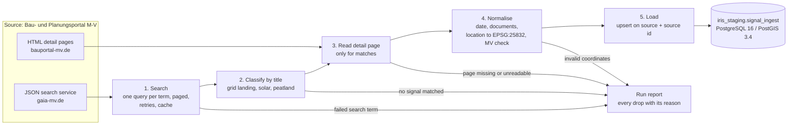
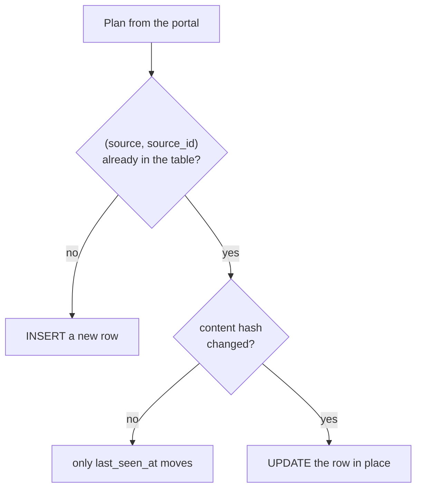
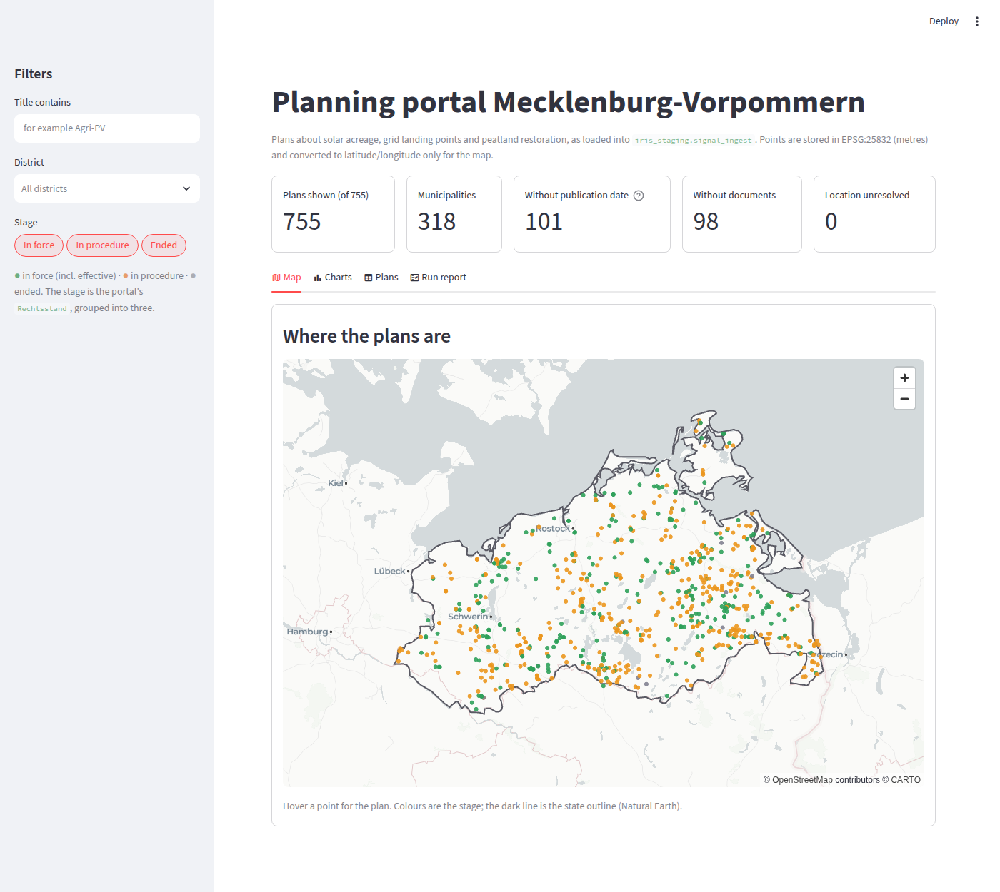
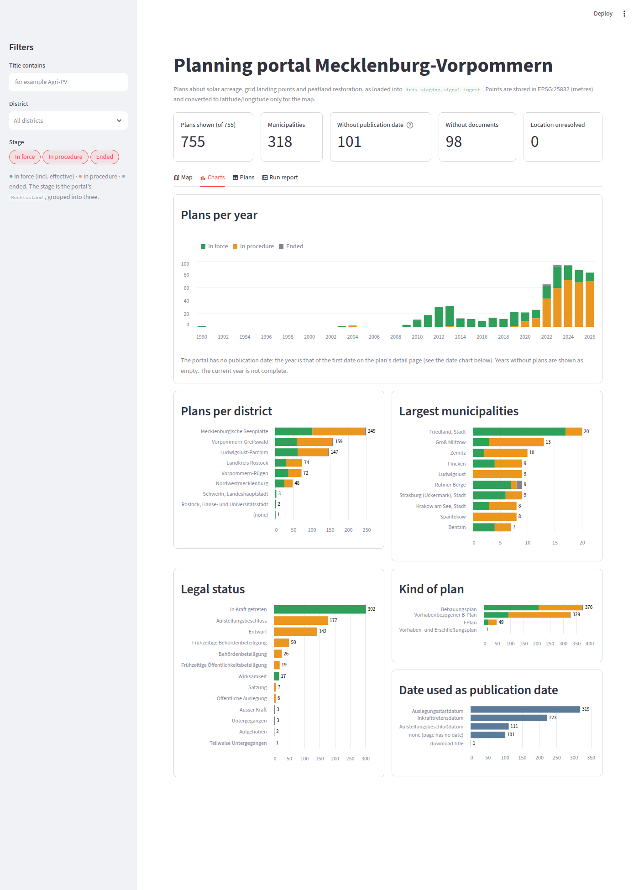

# Mecklenburg-Vorpommern B-Plan portal harvester (IRIS-SIG-13)

Collects planning records of the German state Mecklenburg-Vorpommern (MV) about **Baltic energy grid landing
points**, **solar acreage** and **peatland restoration**, and loads them into PostgreSQL 16 / PostGIS 3.4 as
EPSG:25832 points in `iris_staging.signal_ingest`. A run can be repeated without creating duplicates, and everything
the harvester drops or finds incomplete is listed with the reason.

**Result of a full run (27 October 2026):** 802 distinct candidate plans, **755 solar plans loaded**, no grid landing
and no peatland plans (the portal has none, see [Known limitations](#known-limitations)). A second run changed nothing:
`0 inserted, 0 updated, 755 unchanged`.


## Contents

New here? Read the Quick start, then follow [Usage](#usage) step by step.

1. [Quick start](#quick-start)
2. [Overview](#overview)
3. [Requirements](#requirements)
4. [Setup](#setup)
5. [Usage](#usage)
6. [Troubleshooting](#troubleshooting)
7. [Data source](#data-source)
8. [Assumptions](#assumptions)
9. [Tests](#tests)
10. [Project layout](#project-layout)
11. [Known limitations](#known-limitations)
12. [Development progress](#development-progress)

## Quick start

You need Python 3.11 or newer and Docker. Nothing else has to be configured: the database is created locally by
Docker, `.env.example` holds working defaults, and the portal data of the full run is included.

```bash
git clone https://github.com/arunp77/IRIS-SIG-13.git && cd IRIS-SIG-13
python tasks.py setup       # environment, database and raw data (the first time takes a few minutes)
python tasks.py demo        # the whole pipeline on a small saved sample, run twice
python tasks.py test        # 111 tests
python tasks.py reproduce   # the full run of 755 plans from saved data, then again: nothing changes
python tasks.py validate    # the validation queries: every check returns 0 rows
python tasks.py ui          # dashboard with map and charts (http://localhost:8501)
```

No command needs the portal, a login or a credential. If `python` is not found, use `python3` (Linux, macOS) or `py -3.12` (Windows). On Linux and macOS `make setup`,
`make demo`, ... do the same. If something does not work, see
[Troubleshooting](#troubleshooting).


## Overview

### Objective

Capture Baltic energy grid landing points, solar acreage and peatland restoration proposals.

### Scope and where each point is handled

| Scope in the brief | Where it is done |
|--------------------|------------------|
| Identify the public source, confirm its format, implement the ingestion | The brief's URL is dead; the successor portal is described in [Data source](#data-source) and [docs/source_notes.md](docs/source_notes.md). Code: `source.py` |
| Extract records; keep ids, titles, dates, source URLs, geographic context | `source.py` (search, detail page), `transform.py` (row). Columns: [docs/data_dictionary.md](docs/data_dictionary.md) |
| Normalise, load into `iris_staging.signal_ingest`, repeatable and idempotent | `sql/01_schema.sql` (unique `(source, source_id)`), `load.py` (upsert with content hash) |
| Resolve locations to EPSG:25832 points; document unresolved ones | `transform.locate`: resolved, unresolved or invalid (rejected with a reason). See [Assumptions](#assumptions) |
| Pagination, incremental retrieval, failures, duplicates, malformed data, empty responses | `client.py` (retries, pacing, cache), `source.search` (paging), `load.py`; one test group per case in [Tests](#tests) |

### What is submitted and where it is

| Deliverable | Location |
|-------------|----------|
| Python code, dependency and configuration instructions, no credentials | `src/harvester/`, `pyproject.toml`, `requirements.lock`, `.env.example`, [Setup](#setup) |
| README: data source, mapping assumptions, how to run, limitations | this file |
| Automated tests with fixtures or mocks, including re-run and duplicate behaviour | `tests/`, real saved portal answers in `tests/fixtures/portal/` |
| Sample output | `data/sample/` (full-run report, 25 rows as CSV and GeoJSON, validation output) |
| Validation queries | `sql/02_validation.sql` (`python tasks.py validate`) |
| Concise error and quality report | [docs/quality_report.md](docs/quality_report.md) |

### Acceptance criteria and how to see each one

| Criterion | Evidence | Command |
|-----------|----------|---------|
| Signal type and geographic/domain filtering match the objective | Three signal types with word rules in `config/signals.yaml`; every point is checked against MV; all 755 points lie inside the state outline or within 3 km of it | `python tasks.py qa`, `python tasks.py ui` |
| Valid, traceable records, no duplicates on re-run | Unique `(source, source_id)`; every row keeps its `source_url`, a content hash and the raw record; a second run reports `755 unchanged` | `python tasks.py reproduce`, `python tasks.py validate` |
| Errors and missing fields are visible; invalid coordinates are not silently accepted | The run report lists every plan that was left out, skipped, rejected or incomplete, with the reason; a wrong centroid rejects the record | [Usage, step 7](#7-see-errors-and-missing-fields) |
| Maintainable, configurable, demonstrable without production access | Rules in YAML, settings in `.env`, 111 tests, the full run replays offline from saved portal answers | `python tasks.py demo`, `python tasks.py test` |

### Pipeline



### What happens on a re-run



Nothing is deleted: a plan that disappears from the portal stays in the table and its `last_seen_at` stops moving.

## Requirements

| What | Needed for | Notes |
|------|-----------|-------|
| Python 3.11 or newer | everything | tested on 3.11, 3.12 and 3.13 |
| Docker with the Compose plugin | the local PostGIS database | without Docker see [Without Docker](#without-docker) |
| Internet | `setup` (downloads the packages and the database image), and the optional live harvest | the demo, tests and full replay work offline afterwards |
| Free ports 5434 (database) and 8501 (dashboard) | | a busy database port is replaced automatically |
| `make` | nothing | optional shortcut on Linux and macOS; `tasks.py` does the same everywhere |

Linux was used for development and testing. The Windows-specific parts (paths, UTF-8, no shell commands) were written
for it, but I have not run it on Windows or macOS.

## Setup

```bash
python tasks.py setup      # use e.g. python3.12 or py -3.12 to choose the interpreter
```

What it does, in order (each step is a plain command if you prefer to run it yourself):

1. Creates the virtual environment `.venv` from the Python that started it.
2. Installs the **exact** package versions from `requirements.lock`, then the project itself (`pip install --no-deps -e .`),
   which also provides the `harvest` command.
3. Creates `.env` from `.env.example` (never committed). If port 5434 is taken, it picks the next free one and writes
   it to `.env`.
4. Starts the database: `docker compose up -d --wait` (PostGIS 16 / 3.4, the data lives in a Docker volume).
5. Creates the schema and the table: `harvest --init-db` (safe to repeat).
6. Unpacks the raw portal answers of the full run (786 JSON files) into `data/raw/` and checks every file against
   `data/raw/MANIFEST.csv`.

Configuration is in `.env`; there are no credentials in the code:

| Variable | Meaning |
|----------|---------|
| `POSTGRES_DB`, `POSTGRES_USER`, `POSTGRES_PASSWORD`, `POSTGRES_PORT` | the local database container (a throwaway password, local only) |
| `DATABASE_URL` | used by the harvester, the tests and the dashboard |
| `HARVESTER_CONTACT` | **your** e-mail address; only needed for a live harvest, where it is sent to the portal in the `User-Agent` header. The placeholder is refused |

Other settings (search terms, signal rules) are in `config/signals.yaml`; run options are listed by `harvest --help`.

### Without Docker

Use your own PostgreSQL 16 with PostGIS 3.4 and a database in which the user may create schemas:

```bash
python -m venv .venv && source .venv/bin/activate        # Windows: .venv\Scripts\activate
pip install -r requirements.lock && pip install --no-deps -e .
cp .env.example .env                                     # then set DATABASE_URL to your server
harvest --init-db
python -m harvester.raw unpack
psql "$DATABASE_URL" -f sql/02_validation.sql            # instead of `tasks.py validate`
```

Without any database, `pytest -m "not db"` (99 tests) and `harvest --offline --dry-run` still work.

## Usage

Each step says what you should see. Steps 1 to 8 need only `setup`; none of them needs the portal.

### 1. See the pipeline work on a small sample (demo)

```bash
python tasks.py demo
```

A fake portal built from 9 saved real search answers and 12 real detail pages is served to the harvester, which runs
twice into the database:

```
--- run 1 --------------------------------------------------
  classified  12 kept {'solar_acreage': 12}, 5 matched no signal
  database    12 inserted, 0 updated, 0 unchanged, 0 failed
--- run 2 --------------------------------------------------
  database    0 inserted, 0 updated, 12 unchanged, 0 failed
```

Five of the 17 candidates matched no signal and are listed in `out/demo_report.json`.

### 2. Run the tests

```bash
python tasks.py test
```

`111 passed` in a few seconds. See [Tests](#tests) for what they cover.

### 3. Run the validation queries

```bash
python tasks.py validate
```

Runs `sql/02_validation.sql`: eight checks, each of which must print `(0 rows)` (duplicate source ids, points not in
EPSG:25832, invalid geometry, point and location status disagreeing, points outside MV, missing required fields, rows
that cannot be traced, timestamps out of order), followed by six information tables (rows per signal, missing optional
fields, which portal date was used, and others). The output of the full run is in `data/sample/validation_output.txt`.

### 4. Run the full harvest offline (the 755 plans)

```bash
python tasks.py reproduce
```

Replays the complete run from the saved raw answers in `data/raw/` (no network) and then runs it a second time:

```
Harvest report
  search      1593 records seen, 802 distinct (0 requests, 786 from cache)
  classified  755 kept {'solar_acreage': 755}, 47 matched no signal
  skipped     0 detail page errors, 0 rejected, 0 search problems
  quality     101 without date, 0 without point, 98 without documents
  database    755 inserted, 0 updated, 0 unchanged, 0 failed      <- first run
  database    0 inserted, 0 updated, 755 unchanged, 0 failed      <- second run: no duplicates
```

(If you ran the demo before, the first run says `743 inserted, 12 unchanged`: the 12 demo plans are among the 755.)
The reports are written to `out/full_run.json` and `out/full_run_2.json`.

### 5. Look at the data in the table

```bash
docker compose exec -T db psql -U iris -d iris -c "select signal_type, location_status, count(*) from iris_staging.signal_ingest group by 1,2;"
```

```
  signal_type  | location_status | count
 solar_acreage | resolved        |   755
```

Follow one record back to its source. The point and its SRID, the source link, the portal date that stood in for the
publication date and the raw record are all stored:

```bash
docker compose exec -T db psql -U iris -d iris -x -c "select title, source_url, published_at, raw_payload->>'published_at_basis' as date_basis, ST_AsText(geom) as point, ST_SRID(geom) as srid from iris_staging.signal_ingest where title ilike '%Agri%' limit 1;"
```

The same plan can be found in `data/raw/`: `MANIFEST.csv` names the file for that `source_url`. Every row is traceable
to the exact portal answer it came from.

### 6. Show that a re-run does not duplicate

Run `python tasks.py reproduce` again: both runs now report `0 inserted, 0 updated, 755 unchanged` and the row count
stays 755. Then `python tasks.py validate`: the duplicate check still returns `(0 rows)`. A plan whose content changed
is updated in place; the tests prove this with a changed fixture (`tests/test_load.py`).

### 7. See errors and missing fields

The commands in this step use the tools in the virtual environment, so activate it first: `source .venv/bin/activate`
(on Windows `.venv\Scripts\activate`).

Nothing is dropped silently. The report (`out/full_run.json`) has one list per kind of problem:

| Key | Content |
|-----|---------|
| `unmatched` | plans the search found but no signal rule accepted (47: 40 contain "Moor", 4 "Umspannwerk", 1 "Offshore", 2 other) |
| `rejected` | plans with a coordinate that cannot be right, with the reason (0 in the real data) |
| `detail_errors` | plans whose detail page could not be fetched or read (they are skipped, not loaded half-empty) |
| `search_problems` | search terms that failed |
| `warnings` | incomplete records, e.g. 101 plans whose page has no usable date |
| `quality` | counts of rows without date, without documents, without a point |

Invalid coordinates are refused and say why. These tests feed the location code a coordinate in the usual x,y order,
degrees, a point in Poland, `0,0`, text, a single number and three numbers:

```bash
python -m pytest tests/test_transform.py -k "centroid or location" -v      # 13 tests
```

A run whose source is unavailable says so and exits with code 2 instead of looking clean. Example: offline with an
empty cache folder:

```bash
harvest --offline --dry-run --cache-dir some_empty_folder
```

```
  skipped     0 detail page errors, 0 rejected, 19 search problems
  Search problems: term=Umspannwerk; error=offline: not in the cache: https://www.gaia-mv.de/geoportalsearch/_aja...
```

Exit codes: `0` clean, `2` finished but something failed that a re-run may fix, `1` could not start (for example no
`.env`, or the contact address is still the placeholder).

Filtering by signal: `harvest --offline --dry-run --signal grid_landing` finds 5 candidates and keeps 0, which shows
that the portal has nothing for this signal that the rules accept (see [Known limitations](#known-limitations)).

### 8. See the map and the charts

```bash
python tasks.py qa     # writes out/signal_ingest.geojson, out/signal_ingest_25832.csv and out/quicklook.png
python tasks.py ui     # dashboard on http://localhost:8501
```

`qa` prints `755 points: 744 inside the outline, 11 within 3 km of it, 0 further out`. The dashboard has four tabs and
filters for title, district and stage that apply to all of them:

| Tab | Content |
|-----|---------|
| Map | the points over the MV outline, coloured by stage; hover a point for the plan |
| Charts | plans per year (every year shown, also those without plans), per district, largest municipalities, legal status, kind of plan, and which portal date stood in for the publication date; bars are split by stage in the colours of the map |
| Plans | a table with a link to the portal page of every plan, and a CSV download |
| Run report | the signals with their plan counts, and the plans that were left out, with the reason |

It only reads the table. The map background comes from a public tile server; without internet it is blank but the
points and the outline still show.





### 9. Run against the live portal (optional)

Needs your own e-mail address in `.env` (`HARVESTER_CONTACT`) and internet. With the environment activated:

```bash
harvest --max-details 20 --report out/report.json   # small: first 20 detail pages (python tasks.py harvest)
harvest --dry-run                                   # fetch and check everything, write nothing
harvest --report out/report.json                    # everything: about 790 requests, 2 s apart, 30 minutes or more
python tasks.py fetch                               # like --dry-run; the answers are kept in data/raw/
```

Every answer is cached on disk (`data/raw/`, one JSON file per request), so a second run is quick and an interrupted run
can be continued. The portal offers no "changed since" filter; every run is therefore a full refresh, made cheap by the
cache and the upsert. `--offline` answers only from the cache and never contacts the portal.

### 10. Other commands

| Command | What it does |
|---------|--------------|
| `python tasks.py raw` | unpack and verify `data/raw/*.tar.gz` again |
| `python tasks.py clean` | remove `out/` and the tool caches |
| `python tasks.py` | list all commands |
| `docker compose down` | stop the database (keeps the data); add `-v` to delete it |

## Troubleshooting

| Symptom | Cause and fix |
|---------|---------------|
| `Python 3.11 or newer is needed` | Start the setup with a newer interpreter: `python3.12 tasks.py setup` or `py -3.12 tasks.py setup`. With pyenv: `pyenv install 3.12 && pyenv local 3.12` |
| `python: command not found` | Use `python3 tasks.py ...` (on Windows `py -3.12 tasks.py ...`) |
| `ensurepip is not available` | The Python `venv` module is a separate package on Debian and Ubuntu: `sudo apt install python3-venv`, then run the setup again |
| `permission denied` for the Docker socket | Your user is not in the `docker` group: `sudo usermod -aG docker $USER`, log out and in again |
| `Docker was not found` / `Cannot connect to the Docker daemon` | Install and start Docker (Desktop on Windows and macOS), or use your own PostGIS ([Without Docker](#without-docker)) |
| `port 5434 is in use; the database will use port 5435` | Informational: the next free port was written to `.env` |
| `no virtual environment yet` or `no .env yet` | Run `python tasks.py setup` first |
| `password authentication failed` | The password in `.env` was changed after the container was created. `docker compose down -v` (deletes its data), then `python tasks.py setup` |
| `error: set HARVESTER_CONTACT in .env` | Only a live harvest needs it. Put your own address in `.env`; `demo`, `reproduce` and `--offline` do not need it |
| Database tests are skipped | No database is reachable; start it with `python tasks.py setup`. With `REQUIRE_DB=1` the same situation fails the tests instead of skipping them |
| `reproduce` says answers are not in the cache | `data/raw/` has no unpacked files: `python tasks.py raw` |
| The dashboard says "No plans loaded yet" or "Database not reachable" | Run `python tasks.py reproduce` (or `demo`) first; check that the container is running (`docker compose ps`) |
| The dashboard map is blank | No internet for the map tiles. The points and the outline still show |
| `make: command not found` (Windows) | Use `python tasks.py <command>`; `make` is only a shortcut |
| A live harvest is slow | By design (2 s between requests, about 790 requests). The second run is served from the cache |
| Demo rows are in the way of a check | `docker compose exec -T db psql -U iris -d iris -c "TRUNCATE iris_staging.signal_ingest"`. The tests use their own database (`iris_test`) and ignore them |

## Data source

The URL in the brief, `https://b-plan-mv.de`, **no longer exists** (the domain does not resolve; checked on 27 and
28 October 2026). I used its successor, the state's *Bau- und Planungsportal M-V* (`bplan.geodaten-mv.de/bauportal/`,
also served at `www.bauportal-mv.de`). It has three layers:

| Layer | Used? |
|-------|-------|
| HTML listing pages | no: empty shells that JavaScript fills |
| **JSON search service** `https://www.gaia-mv.de/geoportalsearch/_ajax/search/?type=Bauleitplan&q=<term>&offset=<n>&n=<size>&crs=EPSG:25832`, which the portal documents for third parties | yes: finds the records |
| **HTML detail page** per plan, `https://www.bauportal-mv.de/bauportal/Uebersicht/Details?type=<class>&id=<id>` | yes: the only place with legal-step dates and document links (the "HTML pattern" of the brief) |

So the ingestion is a hybrid of the two: JSON to find, HTML to complete. The details, the access terms and the traps I
found (for example that `total` and `offset` count result groups, not records, that the centroid comes as
*northing,easting*, and that an unknown id returns HTTP 200) are in [docs/source_notes.md](docs/source_notes.md).

Access is lawful and polite: only the documented interface and public pages, a `User-Agent` with a contact address,
2 seconds between requests, retries with growing waits, no bypass of anything. The portal's `robots.txt` is a 404 on
`bauportal-mv.de` and a 503 page on `gaia-mv.de`, so no crawl rules are published. The documents belong to the
municipalities, so **only metadata and links are stored; no document is downloaded.**

The raw answers of the full run (786 files, fetched on 27 October 2026) are included as a compressed archive with a
checksum manifest in `data/raw/`, so the result can be reproduced without the portal.

## Assumptions

Every column is described in [docs/data_dictionary.md](docs/data_dictionary.md). The decisions:

- **Identity and re-runs.** A plan is identified by `(source, source_id)`, the portal's own id. A known plan is rewritten
  only if its content hash changed; otherwise only `last_seen_at` moves. Nothing is deleted.
- **Signal type** is decided by the **title** with the regular expressions in `config/signals.yaml`. The portal's search
  matches inside words (`Moor` finds `Broderstorf`), and `Umspannwerk` or `Offshore` alone usually mean something
  unrelated (a plan next to a substation, a ferry port), so such words only count together with a second word.
- **Location.** The portal gives the centroid as *northing,easting* in EPSG:25832, the reverse of the usual order. It is
  swapped and checked against a box around MV (10.5 to 14.5 E, 53.0 to 54.8 N). No centroid: the row is stored
  `unresolved` without a point and counted. A centroid that cannot be right (usual x,y order, degrees, outside MV): the
  record is **rejected** and reported, never loaded. Only the centroid of a plan is stored, not its outline.
- **Publication date.** The portal has none; the only date in a search record is the time it was indexed. `published_at` is
  a **stand-in**: the first of start of public display, entry into force, council decision that the detail page has. The
  one used is stored in `raw_payload.published_at_basis`. Empty if the page has none.
- **A failed detail page** skips the plan and reports it; loading it without its date and links would overwrite a complete
  row from an earlier run.
- **Documents** are stored as links only.

## Tests

`python tasks.py test` runs 111 tests in about 5 seconds. HTTP is faked with the `responses` library and with real saved
portal answers, so no test needs the portal. The 12 database tests (10 for the loader, 2 for the dashboard page) run in
their own database (`iris_test`, created on first use) and never touch the rows of a real run.

| Required behaviour | Tests |
|--------------------|-------|
| Pagination | `test_source.py` (paging by result groups; an empty page ends the search even if `total` promises more) |
| Network failures | `test_client.py` (retries with growing waits, `Retry-After`, timeouts, give-up after all attempts, 404 not retried) |
| Empty responses | `test_source.py` (answer without results, search term without matches) |
| Malformed data | `test_client.py` (damaged cache entry), `test_source.py`, `test_transform.py` (record without title, bad centroids, missing dates) |
| Duplicates | `test_load.py` (the same plan twice in one batch is loaded once), `test_source.py` (a plan found by two terms is kept once) |
| Re-run behaviour | `test_load.py` (second load changes nothing, changed plan updated in place, failed detail page leaves the stored row untouched), `test_run.py` (whole runs) |
| Invalid coordinates | `test_transform.py` (13 tests, see Usage step 7) |
| Offline operation and raw archive | `test_client.py`, `test_raw.py` (including a tampered archive and path traversal) |
| Dashboard | `test_ui.py` (data functions, empty table, filters, unreachable database) |

Style: `ruff check .` and `ruff format --check .` pass.

## Project layout

```
tasks.py, Makefile        the commands of this README
pyproject.toml            what the program needs; the `harvest` command; test and style settings
requirements.lock         every dependency pinned to an exact version
.env.example              settings for a local run (copy to .env, never committed)
docker-compose.yml        local PostgreSQL 16 / PostGIS 3.4
config/signals.yaml       search terms and the rules that decide the signal type
sql/                      01_schema.sql (the table), 02_validation.sql (the checks)
src/harvester/            client.py (polite HTTP, retries, cache, offline mode)
                          source.py (search paging, detail page parsing)
                          transform.py (classify, locate, choose the date, build the row)
                          load.py (upsert)    run.py (one run, the report, the command line)
                          raw.py (pack, unpack and verify the raw answers)
tests/                    111 tests; fixtures/portal/ holds real saved portal answers
data/raw/                 the raw portal answers: archive + MANIFEST.csv (the unpacked JSON is not committed)
data/reference/           outline of MV for the map and the point check (Natural Earth, public domain)
data/sample/              sample output of the full run: report, validation output, 25 rows as CSV and GeoJSON
scripts/                  the offline demo
qa/                       GeoJSON and CSV export, quick-look map
ui/                       the Streamlit dashboard (app.py) and its data functions (plans.py)
docs/                     source_notes.md, data_dictionary.md, quality_report.md, figures/
```

## Known limitations

- **Only solar plans were found.** The portal holds no grid landing or peatland plans that can be told apart from place
  names: every `Moor` hit is a place or field name, and the `Umspannwerk` and `Offshore` hits are plans next to a
  substation or a ferry-port extension. The rules and the code for all three signals are in place; another source is
  needed for the other two (see the open questions below).
- `published_at` is a stand-in (101 of 755 rows have none); for 112 rows it is the council decision, which comes before
  publication. Whether that is acceptable has to be decided by whoever uses the column.
- The signal is decided by the **title** only; a plan whose title does not name its purpose is missed.
- The MV check is a bounding box (plus an outline test in the quick-look export), not the legal state border.
- Only the centroid of a plan is stored, not its area.
- The portal offers no "changed since" filter, so every run is a full refresh.
- A cold live run takes half an hour or more by design.
- The ingestion is a JSON search plus HTML detail pages, not a pure HTML scrape: the HTML listing pages of the portal are empty shells.
- Tested on Linux only (see [Requirements](#requirements)).

Open questions for the data owner: whether another source (the portal's other GeoPortal layers, for example an offshore
cable layer and peatland datasets) should provide grid landing and peatland records; which date counts as the
publication date; whether plans in draft stage belong in the staging table; and whether an existing definition of
`iris_staging.signal_ingest` has to be followed (this version creates the table itself, see `sql/01_schema.sql`).

---